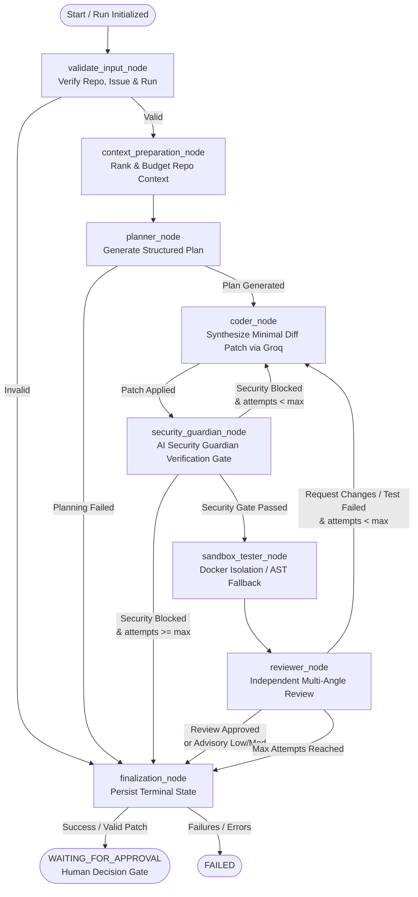

# DevSquad

> **Production-Grade Multi-Agent AI Software Engineering Platform**
> Automated Problem Diagnosis, Real-Time Code Synthesis, Security Gating & Instant GitHub PR/Push

DevSquad ingests GitHub repositories and issues, isolates defects through LangGraph multi-agent orchestration, and synthesizes minimal, test-verified patches using Groq ultra-fast AI inference:

```text
GitHub Repo / Issue → Repository Context → Planner → Coder (Groq) → Security Guardian → Sandbox Tester → Reviewer → Human Gate → Live GitHub PR / Commit
```

[](https://fastapi.tiangolo.com)
[](https://nextjs.org)
[](https://langchain-ai.github.io/langgraph)
[](https://groq.com)
[](https://python.org)
[](https://typescriptlang.org)

---

## Key Capabilities

- **Ultra-Fast LLM Inference via Groq**: Powered by `openai/gpt-oss-120b` (with fallback to Gemini 2.0 Flash and OpenAI GPT-4o).
- **Direct GitHub Repository Inspection**: Pulls recursive file trees and source code directly from GitHub, analyzes stack traces and bug reports, and produces unified diffs with exact context matching.
- **Accurate Clean-Codebase Detection**: Automatically verifies when a repository has 0 open issues or when the codebase is already bug-free, preventing false diagnoses.
- **One-Click GitHub Publishing**:
  - **Commit Directly to Default Branch (`main`)**: Applies the verified unified diff via GitHub Contents API and commits changes immediately.
  - **Automated Pull Request Publication**: Creates a topic branch (`devsquad/fix-...`), commits modified files, and opens a structured PR with diagnostic summaries and verification commands.
  - **Issue Solution Commentary**: Posts formatted root cause breakdowns and unified diffs directly to the GitHub issue thread.
- **AI Security Guardian**: Pre-execution security gate enforcing deterministic secret redaction, Python AST source vulnerability scanning (SQL injection, shell injection, eval, insecure deserialization), dependency risk auditing, and strict fail-closed human approval.
- **Modern Developer-Tool UI**: Linear & Vercel-inspired dark theme (`#06080E`), high-contrast WCAG AA typography, 2-column live pipeline terminal, and real-time subsystem diagnostics.

---

## Architecture & Layout

```text
devsquad/
├── backend/                             # FastAPI Backend Engine & LangGraph Multi-Agent System
│   ├── app/
│   │   ├── main.py                      # FastAPI application entrypoint with CORS & lifespan
│   │   ├── api/
│   │   │   ├── router.py                # Central API v1 router
│   │   │   └── routes/                  # Health, Repositories, Issues, Runs, GitHub, Auth, Overview
│   │   ├── core/                        # Config, Logging, Security, Secret Masking
│   │   ├── db/                          # SQLAlchemy 2.0 async engine, aiosqlite/asyncpg, 8 core models
│   │   ├── schemas/                     # Pydantic V2 validated domain contracts
│   │   ├── services/                    # QuickSolver, GitHubService, HealthService, AI Security Guardian
│   │   │   ├── agents/                  # Planner, Coder, Tester, Reviewer, DiffUtils
│   │   │   └── llm/                     # Groq, OpenAI, Gemini, Synthetic LLM providers
│   │   └── orchestration/               # LangGraph StateGraph, Checkpointers & Node Routing
│   ├── alembic/                         # Async database migrations
│   ├── tests/                           # Complete test suite (133 backend unit & security tests)
│   ├── pyproject.toml                   # Python dependencies & tooling
│   └── .env.example                     # Backend environment configuration template
├── frontend/                            # Next.js 14 Production Frontend (App Router, TypeScript)
│   ├── app/                             # Next.js App Router Pages
│   │   ├── page.tsx                     # Command Center dashboard with live system metrics & solver
│   │   ├── login/page.tsx               # Maintainer Access authentication portal
│   │   ├── repositories/page.tsx        # Connected repository browser & workspace manager
│   │   ├── issues/page.tsx              # GitHub issues stream & defect queue
│   │   ├── runs/page.tsx                # Agent runs history & monitoring
│   │   ├── runs/[id]/page.tsx           # Live execution traces & agent flow stepper
│   │   ├── patches/page.tsx             # Patch Laboratory with unified diff viewer & approval gate
│   │   ├── health/page.tsx              # System diagnostics & health probe monitor
│   │   ├── logs/page.tsx                # Security audit & system logs
│   │   └── settings/page.tsx            # Live subsystem parameters, LLM & datastore status
│   ├── components/                      # Reusable UI component hierarchy
│   │   ├── solver/                      # QuickSolverSection (diagnose, diff viewer, direct commit / PR)
│   │   ├── agents/                      # Visual agent flow diagrams & execution nodes
│   │   ├── runs/                        # GroundedPlanCard, ReviewerCard, TestResultCard, Dispatcher
│   │   ├── patches/                     # Unified DiffViewer & Cryptographic ApprovalModal
│   │   └── layout/                      # Navbar, Sidebar, StatusBadge, DevSquadLogo
│   ├── lib/                             # Typed API client, authentication session management
│   ├── tests/                           # Frontend verification test suite (19 unit tests)
│   ├── tailwind.config.ts               # Custom Charcoal & Cyan/Emerald design system
│   └── .env.example                     # Frontend environment configuration template
├── start_devsquad.ps1                   # Single-command platform launcher for Windows
└── README.md
```

---

## Multi-Agent Workflow Architecture



---

## AI Security Guardian (Mandatory Verification Gate)

DevSquad incorporates an automated **AI Security Guardian** pipeline that analyzes patches immediately after synthesis by the Coder Agent, prior to sandbox execution and human approval.

### Security Scanner Suite
- **Deterministic Secret Scanner:** Intercepts high-confidence credentials (AWS Access Keys, GitHub PATs, Groq/OpenAI API keys, Slack tokens, private keys) and deterministically hashes them with SHA-256 (`[REDACTED_SECRET:<hash>]`). Raw secrets are never stored in databases or emitted in API responses.
- **AST Source Code Scanner:** Python AST analyzer detecting unparameterized SQL queries (`.execute(f"...")`, `%`, `+`), command injection (`subprocess(..., shell=True)`, `os.system`), dynamic code execution (`eval`/`exec`), insecure deserialization (`pickle.loads`, unconstrained `yaml.load`), and weak crypto hashes (`md5`/`sha1`).
- **Dependency Risk Auditor:** Deterministic offline heuristic scanner for manifests (`requirements.txt`, `pyproject.toml`, `package.json`), detecting obsolete/vulnerable packages (`pycrypto`, `pickle5`, `telnetlib`), plaintext repository URLs (`--index-url http://...`), and wildcard version pinning (`*`).
- **Security Regression & Scope Guard:** Flags removal of essential security dependencies (such as `Depends(get_current_user)` or `verify_stream_ticket`) and modifications to protected infrastructure files (`.env`, `alembic.ini`).
- **Policy Engine & Server-Side Gate:** Strictly enforces fail-closed human approval. The approval endpoint (`POST /api/v1/runs/{id}/approve`) rejects any patch without a matching, pristine `SecurityScanRecord` where `status == 'PASSED'` and `critical_count == 0` and `high_count == 0`.

---

## Quickstart & Installation (Windows)

### Prerequisites
1. **Python**: Python 3.11+
2. **Node.js**: Node.js 18+ & npm
3. **Git**: Installed and available in PATH
4. **Docker Desktop** *(Optional)*: If running, container-isolated tests execute in Docker; if unavailable, DevSquad falls back cleanly to deterministic AST static analysis.

### Setup Instructions

#### 1. Backend Setup
```powershell
# Create & activate virtual environment
python -m venv .venv
.\.venv\Scripts\Activate.ps1

# Install backend dependencies
cd backend
pip install -e .
pip install -e ".[dev]"

# Configure environment variables
copy .env.example .env
# Set DEVSQUAD_LLM_PROVIDER=groq and DEVSQUAD_GROQ_API_KEY=gsk_... in .env

# Run database migrations
alembic upgrade head
```

#### 2. Frontend Setup
```powershell
cd frontend
npm install
copy .env.example .env.local
```

---

## Automated Verification

### Backend Pytest Suite (133 passing tests)
```powershell
pytest backend/tests/unit -v
```

### Frontend Test Suite & Linting (19 passing tests, 0 errors)
```powershell
cd frontend
npm test
npm run type-check
```

---

## Running the Platform

You can launch both frontend and backend using the included PowerShell script:
```powershell
.\start_devsquad.ps1
```

Or manually in separate terminals:

### 1. Launch FastAPI Backend Engine
```powershell
cd backend
uvicorn app.main:app --host 127.0.0.1 --port 8000
```
- API Root: [http://127.0.0.1:8000/](http://127.0.0.1:8000/)
- Interactive OpenAPI Docs: [http://127.0.0.1:8000/docs](http://127.0.0.1:8000/docs)
- Subsystem Health: [http://127.0.0.1:8000/api/v1/health](http://127.0.0.1:8000/api/v1/health)

### 2. Launch Next.js Production UI
```powershell
cd frontend
npm run dev
```
- Command Center: [http://localhost:3000/](http://localhost:3000/)
- Repositories: [http://localhost:3000/repositories](http://localhost:3000/repositories)
- Agent Runs: [http://localhost:3000/runs](http://localhost:3000/runs)
- Diagnostics: [http://localhost:3000/health](http://localhost:3000/health)
- Settings: [http://localhost:3000/settings](http://localhost:3000/settings)

---

## License

MIT License. See [LICENSE](LICENSE) for details.
