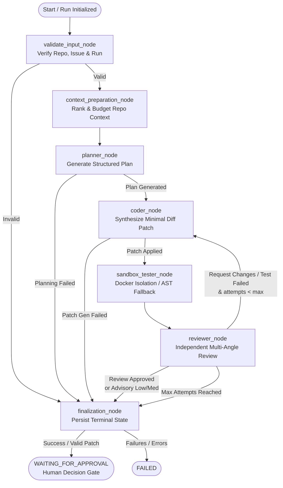

# DevSquad

> **Production-Grade Multi-Agent AI Software Engineering Platform**

DevSquad converts real GitHub issues into verified, reviewable software changes through a controlled multi-agent workflow:
```text
GitHub Issue → Repository Context → Planner → Coder → Sandbox Tester → Independent Reviewer → Human Approval → Pull Request or Patch Export
```

---

## Architecture & Layout

```text
Devsquard/
├── backend/                             # FastAPI Backend Engine & LangGraph Multi-Agent System
│   ├── app/
│   │   ├── main.py                      # FastAPI application entrypoint with CORS & lifespan
│   │   ├── api/
│   │   │   ├── router.py                # Central API v1 router
│   │   │   └── routes/                  # Health, Repositories, Issues, Runs, Auth
│   │   ├── core/                        # Config, Logging, Security, Secret Masking
│   │   ├── db/                          # SQLAlchemy 2.0 async engine, sessions, 8 core models
│   │   ├── schemas/                     # Pydantic V2 validated domain contracts
│   │   ├── services/                    # GitHub API, Context Ranker, LLM providers (Gemini/OpenAI)
│   │   │   └── agents/                  # Planner, Coder, Tester, Reviewer agents
│   │   └── orchestration/               # LangGraph StateGraph, Checkpointers & Node Routing
│   ├── alembic/                         # Async database migrations
│   ├── tests/                           # Complete test suite (179 tests: unit, integration, security)
│   ├── pyproject.toml                   # Python dependencies & tooling
│   └── .env.example                     # Backend environment configuration template
├── frontend/                            # Next.js 14 Production Frontend (App Router, TypeScript)
│   ├── app/                             # Next.js App Router Pages
│   │   ├── page.tsx                     # Command Center dashboard with live system metrics
│   │   ├── login/page.tsx               # Maintainer Access authentication portal
│   │   ├── repositories/page.tsx        # Connected repository browser
│   │   ├── issues/page.tsx              # GitHub issues stream & dispatch modal
│   │   ├── runs/page.tsx                # Agent runs history & monitoring
│   │   ├── runs/[id]/page.tsx           # Live execution traces & agent flow stepper
│   │   ├── patches/page.tsx             # Patch Laboratory with unified diff viewer & approval gate
│   │   ├── health/page.tsx              # System diagnostics & health probe monitor
│   │   ├── logs/page.tsx                # Security audit & system logs
│   │   └── settings/page.tsx            # Maintainer configuration & environment checks
│   ├── components/                      # Reusable UI component hierarchy
│   │   ├── agents/                      # Visual agent flow diagrams & execution nodes
│   │   ├── runs/                        # GroundedPlanCard, ReviewerCard, TestResultCard, Dispatcher
│   │   ├── patches/                     # Unified DiffViewer & Cryptographic ApprovalModal
│   │   └── layout/                      # Navbar, Sidebar, StatusBadge, DevSquadLogo
│   ├── lib/                             # Typed API client, authentication session management
│   ├── tests/                           # Frontend verification test suite
│   ├── tailwind.config.ts               # Custom Charcoal & Lime Green design system
│   └── .env.example                     # Frontend environment configuration template
├── teacher_demonstration_guide.md       # Complete Teacher Demonstration Walkthrough
├── final_verification_report.md         # End-to-end verification audit report (100% passed)
├── IMPLEMENTATION_STATUS.md             # Implementation milestone status report
└── README.md
```

---

## Multi-Agent Workflow Architecture



---

| Method | Endpoint | Description |
|---|---|---|
| `POST` | `/api/v1/runs/{run_id}/start` | Launch or queue a workflow run through LangGraph |
| `POST` | `/api/v1/runs/{run_id}/resume` | Resume an interrupted or waiting run |
| `POST` | `/api/v1/runs/{run_id}/cancel` | Cancel an in-flight run and update state |
| `POST` | `/api/v1/runs/{run_id}/approve` | Cryptographic anti-tamper human patch approval |
| `GET` | `/api/v1/runs/{run_id}/state` | Fetch current typed LangGraph state and snapshot |
| `GET` | `/api/v1/runs/{run_id}/events` | Stream or list real-time agent execution events |

All `/api/v1/runs` endpoints enforce HMAC-SHA256 Bearer token authentication and strict repository ownership authorization (rejecting unauthenticated requests with 401 and cross-user tampering with 403).

---

## Local Development Setup (Windows)

### Prerequisites

1. **Python**: Python 3.11+ (Python 3.13.1 verified).
2. **Node.js**: Node.js 18+ & npm.
3. **Git**: Ensure Git is installed. If missing:
   ```powershell
   winget install --id Git.Git -e --source winget
   ```
4. **Docker Desktop** *(Optional)*: If running, container-isolated tests execute in Docker; if unavailable, DevSquad falls back cleanly to AST static analysis.

### Installation & Setup

#### 1. Backend Setup
```powershell
# Create & activate virtual environment
python -m venv .venv
.\.venv\Scripts\Activate.ps1

# Install backend dependencies
cd backend
pip install -e .
pip install -e ".[dev]"

# Configure environment variables
copy .env.example .env

# Run database migrations
alembic upgrade head
```

#### 2. Frontend Setup
```powershell
# Navigate to frontend and install dependencies
cd frontend
npm install

# Configure environment variables
copy .env.example .env.local
```

---

## Running Automated Verification

### Backend Pytest Suite (179 passing tests)
```powershell
cd backend
pytest -v
```

### Frontend Test Suite & Linting (100% passing, 0 errors)
```powershell
cd frontend
npm test
npm run lint
npx tsc --noEmit
```

---

## Starting the Platform

### 1. Launch FastAPI Backend Engine
```powershell
cd backend
uvicorn app.main:app --reload --host 127.0.0.1 --port 8000
```
- API root: [http://127.0.0.1:8000/](http://127.0.0.1:8000/)
- Interactive Swagger UI: [http://127.0.0.1:8000/docs](http://127.0.0.1:8000/docs)
- Diagnostics & Health Check: [http://127.0.0.1:8000/api/v1/health](http://127.0.0.1:8000/api/v1/health)

### 2. Launch Next.js Production UI
```powershell
cd frontend
npm run dev
```
- Web Application: [http://localhost:3000/](http://localhost:3000/)
- Maintainer Portal: [http://localhost:3000/login](http://localhost:3000/login)
- Patch Laboratory: [http://localhost:3000/patches](http://localhost:3000/patches)

---

## Academic Demonstration & Verification Reports

- **Demonstration Walkthrough:** Review [`teacher_demonstration_guide.md`](./teacher_demonstration_guide.md) for step-by-step guidance on live execution, agent stages, and approval gates.
- **Verification Audit:** Review [`final_verification_report.md`](./final_verification_report.md) for full test metrics, diagnostic results, and architectural compliance evidence.
