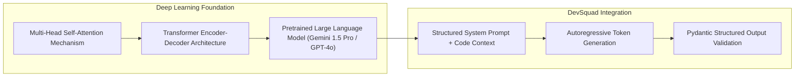
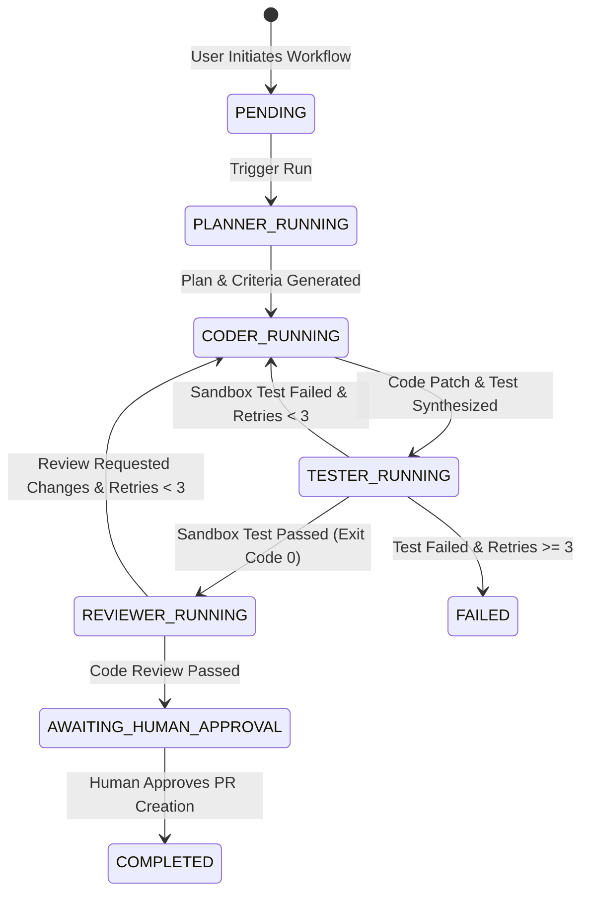

# AI, Machine Learning & Deep Learning Architecture of DevSquad

> **Academic & Technical Blueprint for Professor Evaluation**  
> **Author**: B.Tech CSE Project Team  
> **Target Release**: Sprint 1 (Foundation) | **Target Deadline**: 10 October 2026  

---

## 1. Artificial Intelligence in Software Engineering

DevSquad is an autonomous, AI-driven software engineering platform designed to automate the process of resolving GitHub repository issues. Rather than functioning as a standard auto-completion plugin or an isolated chatbot interface, DevSquad models the full software development lifecycle (SDLC) using **Agentic Artificial Intelligence**.

In DevSquad, AI is applied to solve non-trivial software engineering tasks:
1. **Repository Context Reasoning**: Parsing multi-file repository trees and identifying dependencies relevant to an issue.
2. **Implementation Planning**: Synthesizing high-level issue descriptions into concrete, structured task lists and acceptance criteria.
3. **Code & Test Patch Generation**: Synthesizing syntactically valid unified diffs and corresponding unit tests matching repository conventions.
4. **Automated Verification**: Parsing test runner stdout/stderr in sandboxed environments to detect failure tracebacks.
5. **Auto-Repair Loops**: Bounded iterative refinement loops where diagnostic test failures are fed back into the AI to attempt self-correction.
6. **Code Review & Quality Gate**: Evaluating generated patches for security vulnerabilities (e.g., OWASP top 10), performance degradation, and maintainability.

---

## 2. Machine Learning (ML) Foundations & Future Scope

### Current Implementation Status vs. ML Roadmap
> [!IMPORTANT]
> **Implementation Transparency**: In Sprint 1, DevSquad does **not** train custom Machine Learning models from scratch. Instead, DevSquad integrates pretrained foundation models via standardized API interfaces. Below is the technical formulation of specialized ML components designed for integration in Sprints 5–9.

### Proposed Machine Learning Subsystems

```mermaid
graph TD
    subgraph Data Pipeline
        RAW["GitHub Issue & Repo Metadata"] --> FEAT["Feature Extraction Engine"]
    end

    subgraph ML Models (Planned)
        FEAT --> M1["Task Complexity Classifier (XGBoost / LightGBM)"]
        FEAT --> M2["Test Failure Predictor (Logistic Regression / Random Forest)"]
        FEAT --> M3["Token & Cost Estimation Model (Ridge Regression)"]
    end

    subgraph Operational Applications
        M1 --> A1["Agent Timeout & Budget Allocation"]
        M2 --> A2["Selective Sandbox Test Runner Triggering"]
        M3 --> A3["Cost Governance & Rate Limit Backoff"]
    end
```

#### ML Component 1: Task Difficulty & Risk Scoring Model
- **Input**: GitHub issue title, body text length, number of modified files, historical repository commit churn.
- **Features**: TF-IDF / CodeBERT embeddings of issue body, cyclomatic complexity of target files, repository language composition.
- **Model Architecture**: Random Forest Classifier / XGBoost.
- **Prediction**: Categorical difficulty class (`Simple Bugfix`, `Refactor`, `Feature Addition`, `High-Risk Structural Change`).
- **Application**: Dynamically sets agent iteration limits, LLM temperature parameters, and sandbox resource quotas.

#### ML Component 2: Test Failure & Flakiness Classifier
- **Input**: Execution logs (stdout/stderr), test suite execution duration, assertion failure strings.
- **Features**: N-gram count vectors of error tracebacks, exit codes, module import paths.
- **Model Architecture**: Naive Bayes / Support Vector Machine (SVM) / Fine-tuned DistilBERT.
- **Prediction**: Failure Category (`SyntaxError`, `EnvironmentDependencyMissing`, `AssertionFailure`, `FlakyTimeout`).
- **Application**: Routes failures intelligently—enabling code repair loops for `AssertionFailure` while flagging `EnvironmentDependencyMissing` directly to human maintainers.

#### ML Component 3: LLM Cost & Latency Predictor
- **Input**: Calculated token lengths of repository context files + prompt payload size.
- **Features**: Estimated input tokens, targeted output token budget, selected LLM provider endpoint.
- **Model Architecture**: Linear / Ridge Regression.
- **Prediction**: Estimated cost (USD) and estimated execution latency (seconds).
- **Application**: Displays pre-run cost estimations to users on the dashboard before dispatching long-running multi-agent workflows.

---

## 3. Deep Learning (DL) Architecture

DevSquad leverages state-of-the-art Deep Learning models based on the **Transformer Architecture** (Vaswani et al., 2017).



### Key Deep Learning Concepts Implemented & Utilized:
1. **Multi-Head Self-Attention Mechanisms**: Enables the underlying LLM to model long-range spatial dependencies across distant lines of source code and imported module definitions.
2. **Dense Code Embeddings**: High-dimensional vector representations capturing semantic code equivalence (e.g. mapping code functions with different variable names to identical vector neighborhoods).
3. **Instruction Fine-Tuning & Alignment**: Deep Learning alignment techniques (RLHF/DPO) allowing the foundation model to reliably follow complex engineering instructions and emit valid JSON schemas.

---

## 4. Large Language Models (LLMs) & Prompt Engineering

DevSquad uses a provider-agnostic LLM abstraction layer ([app/core/config.py](file:///c:/Users/SAKSHI%20RAUT/OneDrive/Desktop/stock_signal_generator/backend/app/core/config.py)) capable of communicating with Google Gemini or OpenAI models.

### LLM Architecture Design Rules:
- **System Prompt Scoping**: Every agent node (`Planner`, `Coder`, `Tester`, `Reviewer`) receives strict role-specific system prompts defining operational boundaries.
- **Structured Schema Enforcer**: All LLM completions are constrained using **Pydantic schemas** and strict JSON output parsing, preventing unstructured prose outputs.
- **Context Window Optimization**: Large repository files are truncated and ranked to prevent context window overflow and token waste.

---

## 5. Agentic AI & Multi-Agent Orchestration (LangGraph)

### LLM vs. AI Agent vs. Multi-Agent System

| Aspect | Single LLM Prompt | AI Agent | Multi-Agent System (DevSquad) |
| :--- | :--- | :--- | :--- |
| **Execution Pattern** | One-shot text completion | Sequential tool call loop | Specialized cyclic agent state graph |
| **State Management** | Stateless | Single-agent memory buffer | Centralized `TypedDict` state shared across nodes |
| **Error Recovery** | None | Simple text retry | Graph edge conditional routing & auto-repair loops |
| **Role Specialization**| Generic | Single persona | Dedicated `Planner`, `Coder`, `Tester`, `Reviewer` |

### LangGraph Cyclic Execution Graph



---

## 6. Comprehensive AI / ML / DL / Engineering Roadmap

| Technical Concept | DevSquad Practical Application | Current Status (Sprint 1) | Targeted Sprint |
| :--- | :--- | :--- | :--- |
| **Agentic AI Orchestration** | LangGraph state graph governing cyclic agent execution | **IMPLEMENTED** (State Graph & Schemas) | Sprint 1 |
| **Asynchronous REST API Gateway** | FastAPI async server with system diagnostic checks | **IMPLEMENTED** | Sprint 1 |
| **Datastore State Management** | SQLAlchemy 2.0 ORM models for runs, logs & patches | **IMPLEMENTED** | Sprint 1 |
| **LLM Integration & Prompting** | Gemini / OpenAI provider abstraction & system prompts | **IMPLEMENTED** (Config Layer) | Sprint 1 |
| **GitHub REST API Integration** | Repository metadata, issue fetching & branch creation | **PLANNED** | Sprint 2 |
| **Planner Agent Node** | Contextual issue analysis & structured plan creation | **PLANNED** | Sprint 3 |
| **Coder Agent Node** | Synthesizing unified code diffs & targeted unit tests | **PLANNED** | Sprint 4 |
| **Docker Sandbox Isolation** | Resource-capped rootless code execution container | **PLANNED** | Sprint 5 |
| **Tester & Reviewer Agents** | Failure traceback parsing & auto-repair iteration loop | **PLANNED** | Sprint 6 |
| **Machine Learning Task Classifier** | XGBoost model predicting issue resolution difficulty | **PLANNED** | Sprint 9 |
| **Code Embeddings & RAG** | Vector search over large codebase file trees | **PLANNED** | Sprint 9 |
