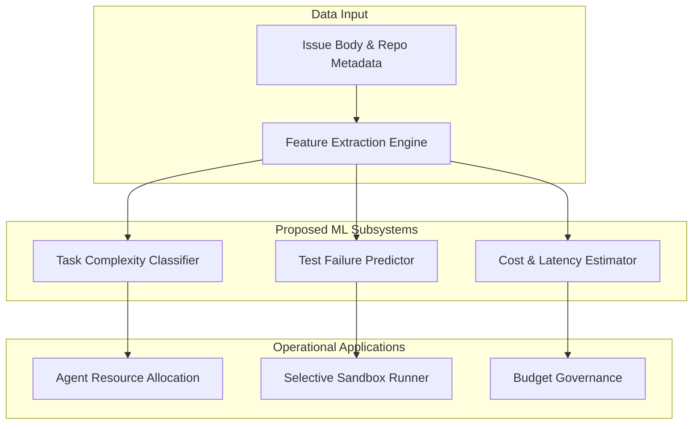
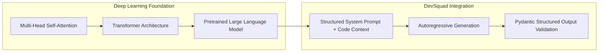
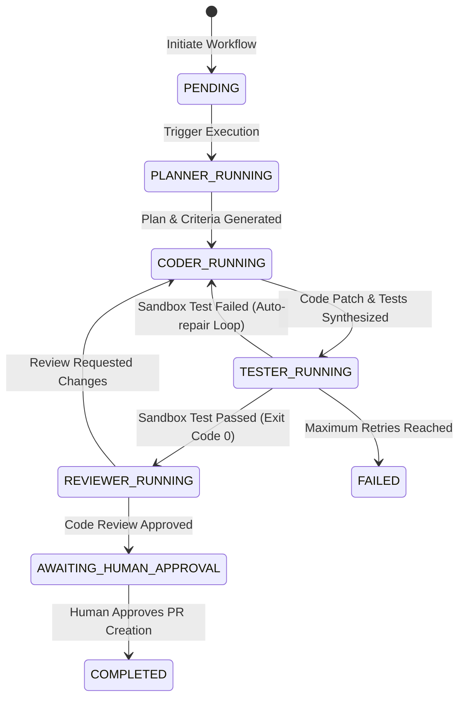

# DevSquad AI Architecture

> **Technical Architecture Specification**  
> **System**: DevSquad AI Software Engineering Platform  

---

## 1. Architecture Overview

DevSquad is an AI-assisted software engineering platform designed to streamline issue resolution and software modification workflows. Rather than operating as a simple inline auto-completion tool or unstructured chatbot, DevSquad uses an **agent-oriented architecture** to coordinate software engineering tasks across the development lifecycle.

The platform applies AI across key engineering domains:
1. **Context Analysis**: Analyzing repository structure, file dependencies, and issue descriptions.
2. **Structured Planning**: Formulating task breakdowns and acceptance criteria prior to code generation.
3. **Patch Synthesis**: Synthesizing targeted code diffs and unit test modifications matching repository style.
4. **Validation Analysis**: Parsing test execution outputs to identify failure tracebacks.
5. **Quality Review**: Evaluating generated code changes for maintainability, security, and criteria compliance.

---

## 2. Machine Learning (ML) Foundations & Product Direction

### Current Implementation vs. ML Roadmap
> [!NOTE]
> DevSquad integrates pretrained foundation models via standardized API interfaces. Below is the technical specification for specialized Machine Learning components designed for future integration into the platform.

### Proposed Machine Learning Subsystems

#### 1. Task Difficulty Classifier
- **Input**: Issue title, body text, modified file count, historical repository churn.
- **Features**: Vector embeddings of issue text, cyclomatic complexity of target files.
- **Target Model**: Gradient Boosting / Random Forest Classifier.
- **Prediction**: Complexity tier (`Simple Bugfix`, `Refactor`, `Feature Addition`, `High-Risk Change`).
- **Application**: Dynamically adjusts agent reasoning depth, LLM token limits, and sandbox execution timeouts.

#### 2. Test Failure Classifier
- **Input**: Execution logs (stdout/stderr), test suite duration, assertion failure text.
- **Features**: N-gram count vectors of tracebacks, exit codes, module import paths.
- **Target Model**: Text Classification Model / Fine-tuned Transformer.
- **Prediction**: Failure Category (`SyntaxError`, `DependencyMissing`, `AssertionFailure`, `FlakyTimeout`).
- **Application**: Routes failures intelligently—enabling targeted auto-repair attempts for `AssertionFailure` while flagging missing environment dependencies to human maintainers.

#### 3. LLM Cost & Latency Estimator
- **Input**: Token lengths of repository context files + prompt payload.
- **Features**: Estimated input tokens, targeted output token budget, selected LLM provider.
- **Target Model**: Ridge Regression.
- **Prediction**: Estimated execution cost (USD) and latency (seconds).
- **Application**: Provides pre-execution cost transparency on the dashboard before starting long-running workflows.

---

## 3. Deep Learning Architecture

DevSquad leverages transformer-based Deep Learning models for natural language and source code reasoning.

### Core Deep Learning Concepts:
1. **Multi-Head Self-Attention**: Enables the underlying language model to represent long-range dependencies across distant lines of source code and module imports.
2. **Code Embeddings**: Dense vector representations capturing semantic equivalence between distinct code patterns.
3. **Instruction Alignment**: Pretrained instruction-tuning and alignment techniques that enable language models to reliably output valid JSON schemas.

---

## 4. Large Language Models (LLMs) & Prompt Design

DevSquad includes a provider-agnostic LLM integration layer ([backend/app/core/config.py](file:///c:/Users/SAKSHI%20RAUT/OneDrive/Desktop/stock_signal_generator/backend/app/core/config.py)) designed to interface with foundation model providers such as Gemini or OpenAI.

### Design Principles:
- **Scoped System Prompts**: Operational roles receive targeted prompts establishing functional boundaries.
- **Structured Output Constraints**: All completions are validated using **Pydantic schemas** to enforce structured JSON responses.
- **Context Management**: Source files are parsed and structured to optimize token utilization and maintain input relevance.

---

## 5. Agentic AI & Orchestration (LangGraph Engine)

### LLM vs. AI Agent vs. Multi-Agent Systems

| Dimension | One-Shot LLM Call | Single AI Agent | Multi-Agent System (DevSquad) |
| :--- | :--- | :--- | :--- |
| **Execution** | Single prompt completion | Sequential tool use | Specialized cyclic state machine |
| **State** | Stateless | Local buffer | Centralized shared state (`TypedDict`) |
| **Error Handling** | None | Simple text retry | Graph edge conditional routing & auto-repair |
| **Roles** | Single persona | Single persona | Specialized `Planner`, `Coder`, `Tester`, `Reviewer` |

### LangGraph State Machine Architecture

---

## 6. Implementation Matrix

| Technical Subsystem | DevSquad Application | Current Status |
| :--- | :--- | :--- |
| **State Machine Engine** | LangGraph cyclic graph & state schemas | **IMPLEMENTED** (Foundation Schema) |
| **Async API Gateway** | FastAPI async server with system health endpoints | **IMPLEMENTED** |
| **Datastore Persistence** | SQLAlchemy 2.0 ORM models for runs, logs & patches | **IMPLEMENTED** |
| **LLM Gateway Abstraction**| Configuration layer for Gemini / OpenAI providers | **IMPLEMENTED** |
| **GitHub Integration** | Repository metadata & issue context extraction | **PLANNED** |
| **Planner Subsystem** | Contextual issue analysis & structured task list synthesis | **PLANNED** |
| **Coder Subsystem** | Unified code diff generation & test synthesis | **PLANNED** |
| **Docker Sandbox** | Resource-constrained rootless execution container | **PLANNED** |
| **Tester & Reviewer Subsystems**| Traceback parsing & auto-repair iteration loop | **PLANNED** |
| **ML Task Difficulty Model**| Machine learning complexity prediction model | **PLANNED** |
