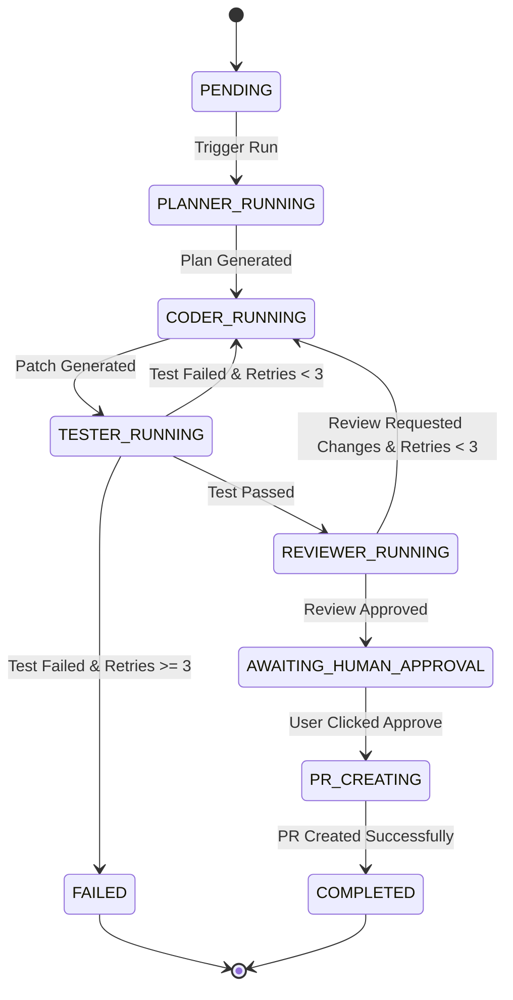

# DevSquad System Architecture Blueprint

## System Concept

**DevSquad** is designed as a modular, event-driven autonomous multi-agent software engineering system. Unlike naive single-prompt code generators, DevSquad models the complete lifecycle of a software engineering team responding to an issue filed on GitHub.

```mermaid
graph TB
    subgraph Client Layer
        UI["Next.js 14 Web Dashboard"]
    end

    subgraph API & Gateway Layer
        API["FastAPI App (ASGI)"]
        AUTH["Auth & JWT Middleware"]
        WS["WebSocket Notification Hub"]
    end

    subgraph Persistence Layer
        DB[(PostgreSQL Database)]
        REDIS[(Redis Cache / Message Broker)]
    end

    subgraph Orchestration Engine (LangGraph)
        STATE["LangGraph Execution State"]
        PLANNER["Planner Agent Node"]
        CODER["Coder Agent Node"]
        TESTER["Tester Agent Node"]
        REVIEWER["Reviewer Agent Node"]
    end

    subgraph Security Sandbox
        DOCKER["Docker Daemon API"]
        SANDBOX["Isolated Ephemeral Container"]
    end

    subgraph External Interfaces
        GH["GitHub REST / App API"]
        LLM["LLM Provider (Gemini / OpenAI API)"]
    end

    UI <-->|HTTP REST / WS| API
    API --> AUTH
    API --> WS
    API <--> DB
    API <--> REDIS
    API --> STATE
    STATE --> PLANNER
    STATE --> CODER
    STATE --> TESTER
    STATE --> REVIEWER
    PLANNER & CODER & TESTER & REVIEWER <--> LLM
    PLANNER & CODER & REVIEWER <--> GH
    TESTER <--> DOCKER
    DOCKER --> SANDBOX
```

---

## Component Specifications

### 1. Client Layer (`frontend/`)
- Built with **Next.js 14 App Router**, **TypeScript**, **Tailwind CSS**, and **shadcn/ui**.
- Real-time workflow state observation via WebSocket connection to FastAPI server.
- Visual Unified Diff Viewer highlighting patch additions/deletions.
- Interactive timeline tracking current agent node (`Plan`, `Code`, `Test`, `Review`).
- Human Approval Modal triggering branch creation and Pull Request generation.

### 2. API & Gateway Layer (`backend/app/api/`)
- Built with **FastAPI** leveraging Python's `asyncio` loop.
- **REST Endpoints**:
  - `GET /health` & `GET /api/v1/system/status`: System diagnostic status.
  - `POST /api/v1/auth/`: OAuth & GitHub token exchange.
  - `GET /api/v1/repos/`: Connected GitHub repositories.
  - `GET /api/v1/issues/`: Synced repository issues.
  - `POST /api/v1/runs/`: Trigger agent workflow run for a selected issue.
  - `POST /api/v1/runs/{id}/approve`: Human approval gateway for PR submission.

### 3. Orchestration Engine (`backend/app/agents/`)
- Driven by **LangGraph**, providing stateful cyclic multi-agent graph execution:
  1. **Planner Agent Node**: Scans repository tree and issue description, producing an `ImplementationPlan` Pydantic object.
  2. **Coder Agent Node**: Reads target files, generates code patches, and synthesizes unit tests.
  3. **Tester Agent Node**: Invokes Docker execution sandbox, parses test runner exit code, stdout, and stderr. If tests fail and `retry_count < 3`, routes back to Coder Agent Node with error traceback.
  4. **Reviewer Agent Node**: Evaluates patch quality against security, maintainability, and criteria rules.

### 4. Security Sandbox (`docker/`)
- Ephemeral rootless Docker containers spun up on-demand by the backend Docker service wrapper.
- **Security Constraints**:
  - `read_only=True` for container root filesystem.
  - Resource limits: `cpus=1.0`, `mem_limit="512m"`.
  - Security options: `no-new-privileges:true`, dropped capabilities (`ALL`).
  - Network isolation during test execution phase.

---

## State Transition Machine (LangGraph)


