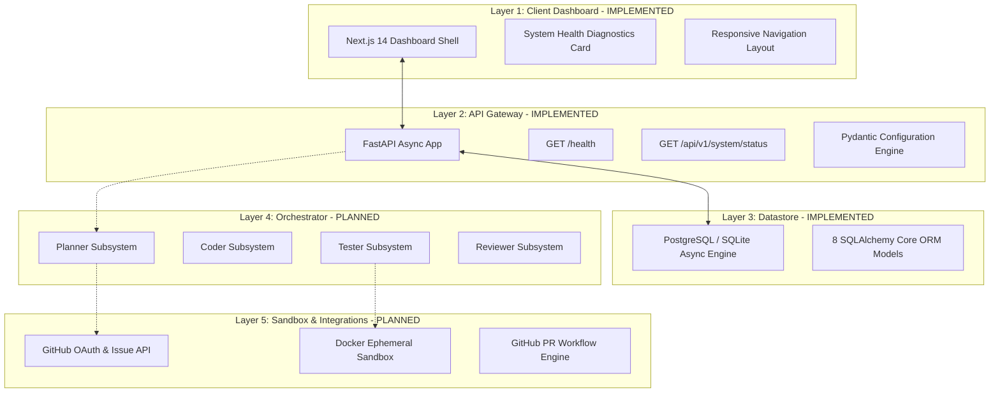

# DevSquad System Architecture Blueprint

> **System Blueprint**: DevSquad Platform Architecture  
> **Document Status**: Active Technical Specification  

---

## 1. System Context & Overview

**DevSquad** is designed as a modular, event-driven platform for automated software engineering workflows. The platform combines a modern reactive web dashboard, an asynchronous REST API, a relational datastore, and a stateful AI orchestration engine.

```
                    +----------------------------------+
                    |          USER DEVELOPER          |
                    +----------------------------------+
                                     |
                                     v
                    +----------------------------------+
                    |        NEXT.JS 14 FRONTEND       |
                    |  (TypeScript, Tailwind, shadcn)  |
                    +----------------------------------+
                                     |
                      HTTP REST / WebSockets Connection
                                     |
                                     v
                    +----------------------------------+
                    |       FASTAPI BACKEND API        |
                    |   (Async ASGI, CORS, Security)   |
                    +----------------------------------+
                                     |
           +-------------------------+-------------------------+
           |                                                   |
           v                                                   v
+-----------------------+                           +-----------------------+
|  APPLICATION SERVICES |                           |  DATABASE (PostgreSQL)|
|  Config, Auth, Logging|                           |  SQLAlchemy 2.0 ORM   |
+-----------------------+                           +-----------------------+
           |
           v
+---------------------------------------------------------------------------+
|                      LANGGRAPH ORCHESTRATION ENGINE                       |
|                     (Stateful Cyclic Execution Graph)                     |
+---------------------------------------------------------------------------+
           |
     +-----+-----+-----+-----+
     |           |           |           |
     v           v           v           v
+---------+ +---------+ +---------+ +----------+
| PLANNER | |  CODER  | | TESTER  | | REVIEWER |
| SUBSYS  | | SUBSYS  | | SUBSYS  | | SUBSYS   |
| (PLANNED| | (PLANNED| | (PLANNED| | (PLANNED |
| FEATURE)| | FEATURE)| | FEATURE)| | FEATURE) |
+---------+ +---------+ +---------+ +----------+
     |           |           |           |
     +-----------+-----+-----+-----------+
                       |
                       v
         +---------------------------+
         |   LLM PROVIDER LAYER      |
         |  (Gemini 1.5 Pro / GPT-4o)|
         +---------------------------+
                       |
         +-------------+-------------+
         |                           |
         v                           v
+------------------+       +-------------------+
|  GITHUB API      |       |  DOCKER SANDBOX   |
| (REST / App API) |       | (Resource Capped  |
| [PLANNED FEATURE]|       |  Ephemeral Cont.) |
+------------------+       | [PLANNED FEATURE] |
                           +-------------------+
```

---

## 2. Component Implementation Status Matrix


